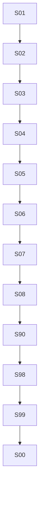

# Snowflake 온톨로지 구축 및 Cortex Agent 연계 교육자료 인덱스 (EDU-06)

> 이 문서는 `99_generate_index.py`에 의해 자동 생성된 인덱스입니다. 직접 수정하지 마십시오.

## 1. 실습 문서 목록

| 번호 | 문서 / 스크립트 | 유형 | 제목 및 요약 | 선수 문서 (Requires) | 다음 단계 (Next) |
| :---: | :--- | :---: | :--- | :--- | :--- |
| **01** | [`01_교육자료_정리본.md`](./01_교육자료_정리본.md) | `document` | **Snowflake 온톨로지 구축 및 Cortex Agent 연계 교육자료 정리본** 온톨로지(지식 그래프, Recursive CTE, Flattened GraphRAG, 용어 매핑) 기반 Cortex Agent 추론 아키텍처 및 실습 교육자료 총괄 정리본. Baseline Agent 와 온톨로지 그라운딩 Agent 를 실제로 만들어 같은 질문에 대한 동작을 비교합니다. | - | `02_환경설정_및_스냅샷.sql` |
| **02** | [`02_환경설정_및_스냅샷.sql`](./02_환경설정_및_스냅샷.sql) | `sql` | **온톨로지 실습 환경설정 및 사전 스냅샷** 실습 전 환경 상태 스냅샷 서식 확인, 전용 역할/웨어하우스/데이터베이스 생성 및 Cortex 가용 모델 사전 점검 | `01_교육자료_정리본.md` | `03_온톨로지_데이터모델_구축.sql` |
| **03** | [`03_온톨로지_데이터모델_구축.sql`](./03_온톨로지_데이터모델_구축.sql) | `sql` | **온톨로지 지식 그래프 데이터 모델 구축** 온톨로지 엔티티 노드(KG_NODE) 및 관계 엣지(KG_EDGE) 테이블 생성 및 세포 계통 도메인 지식 그래프 데이터 적재 | `02_환경설정_및_스냅샷.sql` | `04_비즈니스_실측데이터_적재.sql` |
| **04** | [`04_비즈니스_실측데이터_적재.sql`](./04_비즈니스_실측데이터_적재.sql) | `sql` | **비즈니스 실측 데이터 적재 및 기본 분석 뷰 구축** PRISM 약물 스크리닝 반응도 실측 데이터(SCREENING_VIABILITY) 적재 및 도메인 분석 뷰 생성 | `03_온톨로지_데이터모델_구축.sql` | `05_재귀CTE_그래프순회_프로시저.sql` |
| **05** | [`05_재귀CTE_그래프순회_프로시저.sql`](./05_재귀CTE_그래프순회_프로시저.sql) | `sql` | **Recursive CTE 기반 그래프 순회 프로시저 구현** 계층 하향(자손) 및 상향(조상) 경로를 탐색하고 사이클을 방지하는 Recursive CTE 기반 저장 프로시저(SP_GET_ANCESTORS, SP_EXPAND_COHORT) 구현 | `04_비즈니스_실측데이터_적재.sql` | `06_Flattened_GraphRAG_프로파일_생성.sql` |
| **06** | [`06_Flattened_GraphRAG_프로파일_생성.sql`](./06_Flattened_GraphRAG_프로파일_생성.sql) | `sql` | **Flattened GraphRAG 비정형 프로파일 테이블 생성** 런타임 지식 그래프 순회 부하를 제거하기 위해 온톨로지 계층 및 하위 속성을 단일 비정형 문서 프로파일로 사전 롤업(Rollup)하는 테이블 구축 | `05_재귀CTE_그래프순회_프로시저.sql` | `07_CortexSearch_온톨로지_인덱싱.sql` |
| **07** | [`07_CortexSearch_온톨로지_인덱싱.sql`](./07_CortexSearch_온톨로지_인덱싱.sql) | `sql` | **Cortex Search 온톨로지 하이브리드 인덱싱** Flattened GraphRAG 프로파일을 대상으로 키워드/벡터 하이브리드 검색을 수행하는 Cortex Search 서비스 생성 및 도메인 유의어 검색 검증 | `06_Flattened_GraphRAG_프로파일_생성.sql` | `08_온톨로지_그라운딩_CortexAgent_구현.sql` |
| **08** | [`08_온톨로지_그라운딩_CortexAgent_구현.sql`](./08_온톨로지_그라운딩_CortexAgent_구현.sql) | `sql` | **온톨로지 그라운딩 Cortex Agent 및 용어 매핑 구현** 실측 데이터용 Semantic View 를 만들고, Analyst 만 쓰는 Baseline Agent 와 온톨로지 검색(Cortex Search) + 용어 매핑 규칙을 갖춘 Grounded Agent 를 CREATE AGENT 로 구현해 같은 질문에 대한 도구 사용과 답변을 SQL 정답 기준과 비교합니다. | `07_CortexSearch_온톨로지_인덱싱.sql` | `90_아키텍처_심화_및_벤치마크_분석.md` |
| **90** | [`90_아키텍처_심화_및_벤치마크_분석.md`](./90_아키텍처_심화_및_벤치마크_분석.md) | `document` | **온톨로지 아키텍처 심화 및 벤치마크 분석** 바이오메디컬 22개 질의 벤치마크 결과 상세 분석, 4대 아키텍처 비교, 도구 복잡도 vs 검색 단순화 트레이드오프 및 엔터프라이즈 도입 가이드 | `08_온톨로지_그라운딩_CortexAgent_구현.sql` | `98_리소스정리.sql` |
| **98** | [`98_리소스정리.sql`](./98_리소스정리.sql) | `sql` | **온톨로지 실습 리소스 완전 정리** 실습 중 생성된 모든 객체(Cortex Agent 2종, Semantic View, Cortex Search 서비스, 테이블, 뷰, 프로시저, DB, WH, ROLE)를 객체 대장과 1:1 대조하여 안전하고 멱등하게 완전 정리 | `08_온톨로지_그라운딩_CortexAgent_구현.sql`, `90_아키텍처_심화_및_벤치마크_분석.md` | `99_generate_index.py` |
| **99** | [`99_generate_index.py`](./99_generate_index.py) | `script` | **온톨로지 교육자료 인덱스 자동 생성기** 메타 주석 블록을 파싱하여 00_index.md 문서를 멱등하게 자동 생성하는 Python 스크립트 | - | `00_index.md` |

## 2. 실습 진행 순서도

